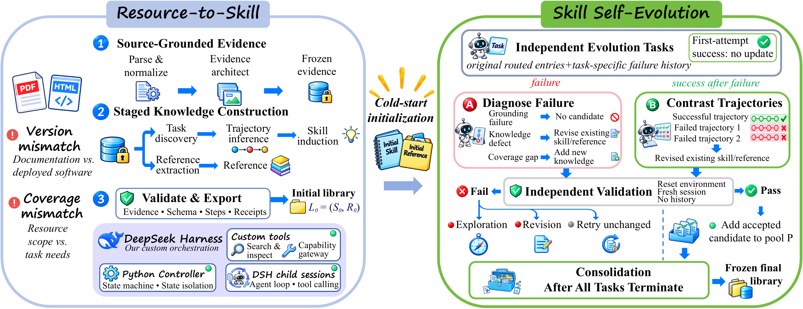

# ScienceCUA

[](https://deepautonomy-ai.github.io/ScienceCUA-website/)
[](https://arxiv.org/abs/2611.03238)
[](https://huggingface.co/lidaiqiang/ScienceBoard_Verified_Env)

**Resource-to-Skill Construction for Scientific Computer Use Agents**

Turn scientific software documentation into reusable Skills and queryable References.

The static paper website and local preview instructions are available in
[`website/`](website/README.md).

<a name="overview"></a>

## 🧭 Overview

ScienceCUA equips computer-use agents with scientific software expertise through
Resource-to-Skill construction and execution-guided skill self-evolution.

The Resource-to-Skill stage builds an initial knowledge library directly from
PDF and HTML software documentation. It organizes source content into traceable
evidence, discovers supported tasks, infers operational trajectories, and
abstracts them into reusable **Skills**. In parallel, it organizes shared
knowledge, such as command catalogs, syntax rules, parameter constraints, and
shortcuts, into queryable **References**.



<a name="quick-start"></a>

## 🚀 Quick Start

Requires Python 3.11 or newer and access to a model API that supports tool calling.
Installation and startup have been verified on Windows with Python 3.12.

From PowerShell:

```powershell
git clone https://github.com/DeepAutonomy-AI/ScienceCUA.git
cd ScienceCUA
python -m venv .venv
.\.venv\Scripts\python.exe -m pip install -e .
powershell -NoProfile -ExecutionPolicy Bypass -File .\start-local.ps1
```

Open [http://127.0.0.1:8000](http://127.0.0.1:8000), then:

1. Enter the target software, version, and platform.
2. Configure your model API endpoint, model name, protocol, and API key.
3. Supply a PDF/HTML file or URL, or search for documentation and select a source.
4. Start construction, inspect the results, and export the Skills and References.

Automatic discovery requires a working web-search API. You can also supply
files or URLs directly.

Generated entries and audit files are saved under `output/`. Source captures and
run state are stored under `data/`. Both directories are local and excluded from Git.

<a name="release-scope"></a>

## 📦 Release Scope

This release includes the **Resource-to-Skill** stage: PDF/HTML source processing,
automatic manual discovery, a local web interface, a command-line runner, and
Skill/Reference construction and export.

Execution-guided skill self-evolution and the benchmark components described in
the paper are planned for future releases.

<a name="acknowledgments"></a>

## 🙏 Acknowledgments

The Resource-to-Skill pipeline of ScienceCUA is built on **DeepSeek Harness SDK
and its native runtime**. We thank the DeepSeek Harness team for providing the
infrastructure for agent execution, session management, and tool calling.

We thank **FastAPI, PyMuPDF, pypdf, Beautiful Soup**, and other open-source
projects and their contributors for supporting the web services and PDF/HTML
source processing in this project.

We also thank the developers and documentation authors of scientific software.
Their manuals, tutorials, and technical documentation provide the knowledge
foundation for constructing Skills and References from source resources.
